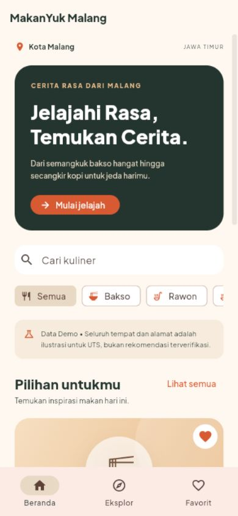
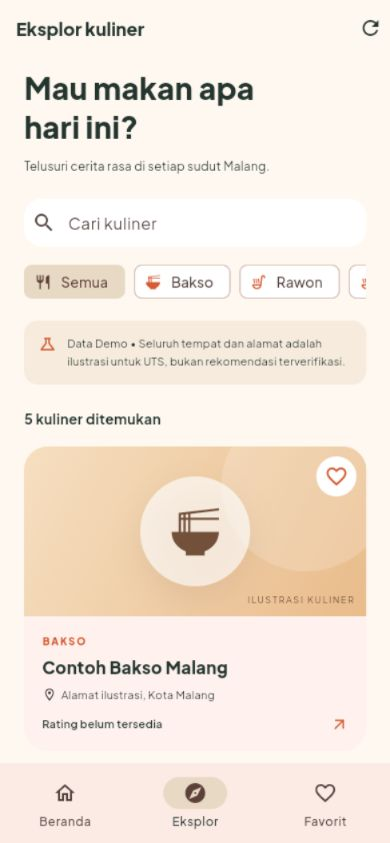
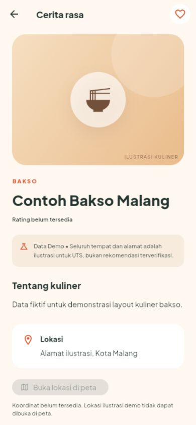
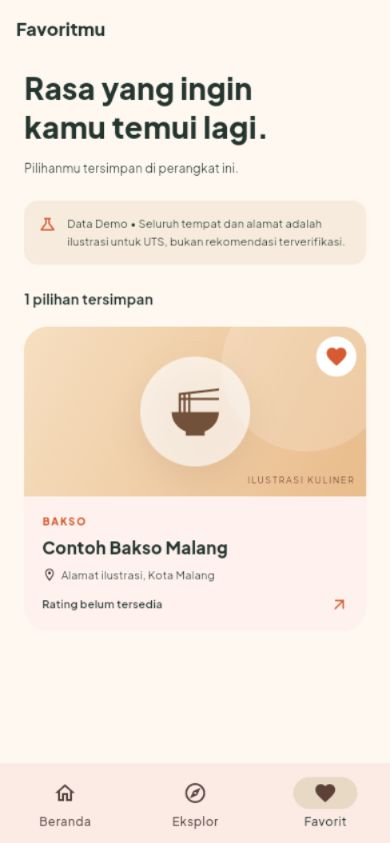

# LAPORAN PROYEK UTS
# MAKANYUK MALANG

Aplikasi Eksplorasi Kuliner Berbasis Flutter

Mata Kuliah Mobile Programming

[Logo fakultas resmi - lengkapi sebelum pengumpulan]

Disusun oleh:

Aldza Salwatul Aisy

NIM 240605110227

Kelas: [isi kelas]

Fakultas / Program Studi: [isi identitas resmi]

[NAMA PERGURUAN TINGGI]

2026

---
# DAFTAR ISI

BAB I PENDAHULUAN

1.1 Latar Belakang dan Gambaran Aplikasi

1.2 Tujuan dan Fitur Aplikasi

BAB II PEMBAHASAN

2.1 Persiapan Project dan Package

2.2 Perancangan Antarmuka

2.3 Implementasi Halaman dan Navigasi

2.4 Pengolahan JSON, Favorit dan Tautan Eksternal

2.5 Integrasi REST API

2.6 Pengujian dan Hasil Pembahasan

BAB III PENUTUP

3.1 Kesimpulan

3.2 Saran

DAFTAR PUSTAKA

Susunan bab mengikuti contoh LangitKita. Materi disesuaikan dengan aplikasi MakanYuk dan ketentuan UTS: judul, pendahuluan, perancangan UI, implementasi, hasil dan pembahasan, serta kesimpulan.

Status dokumen: kelas, fakultas, kampus dan logo resmi masih perlu dilengkapi. Screenshot merupakan dokumentasi Flutter web tahap awal dengan lima contoh fiktif; bukan bukti tampilan terbaru 15 referensi atau pengujian Android fisik. Lihat docs/VALIDATION.md untuk hasil pemeriksaan terbaru.

---
# BAB I - PENDAHULUAN

## 1.1 Latar Belakang dan Gambaran Aplikasi

Mahasiswa, warga lokal dan wisatawan memerlukan cara sederhana untuk mencari inspirasi makan di Kota Malang. Informasi yang tersebar menyulitkan pengguna membandingkan jenis kuliner dan menyimpan pilihan. MakanYuk Malang menyajikan informasi dalam kategori, kartu dan detail yang mudah ditelusuri.

Aplikasi dibangun menggunakan Flutter dan Dart dengan Material 3. Pengguna dapat mencari nama kuliner, memilih kategori, membaca detail dan menyimpan favorit. Tema kuliner dipilih karena dekat dengan kebutuhan sehari-hari dan dapat digunakan untuk menerapkan layout, widget serta navigasi mobile.

## 1.2 Tujuan dan Fitur Aplikasi

Tujuan pengembangan adalah menghasilkan aplikasi UTS yang fungsional sekaligus menunjukkan pengolahan JSON, navigasi antarhalaman, state aplikasi dan penyimpanan lokal. Arsitektur menjaga akses data terpisah dari tampilan sehingga integrasi server dapat diganti tanpa menulis ulang halaman.

| Fitur | Fungsi |
| Beranda | Branding, pencarian, kategori dan tiga pilihan awal. |
| Eksplor | Seluruh data, filter kategori dan jumlah hasil pencarian. |
| Detail | Nama, alamat, deskripsi, ilustrasi, favorit dan tautan. |
| Favorit | Simpan/hapus ID melalui SharedPreferences. |
| Google / Maps | Pencarian nama 15 referensi kuliner melalui aplikasi eksternal. |
| Keadaan UI | Loading, kosong, error, coba lagi dan detail tidak ditemukan. |

JSON lokal berisi 15 referensi tempat nyata dan lima contoh fiktif berawalan Contoh. Referensi statis tidak mengklaim rating, harga, jam buka atau koordinat terkini. Login, pemesanan, pembayaran dan delivery berada di luar lingkup proyek.

---
# BAB II - PEMBAHASAN

## 2.1 Persiapan Project dan Package

Proyek menggunakan Flutter 3.47.2 dan Dart 3.13.2. Source aplikasi yang sama mendukung Android, preview web dan runner Windows. Untuk menjalankan desktop Windows diperlukan Visual Studio beserta workload Desktop development with C++.

```text
flutter pub get
flutter run -d windows
# Target mobile:
flutter run -d <device-id-android>
```

| Package | Kegunaan |
| flutter_riverpod | Shared state dan viewmodel. |
| go_router | Tab utama dan detail dengan ID stabil. |
| http | Client REST dengan validasi dan timeout. |
| shared_preferences | Persistensi ID favorit lokal. |
| url_launcher | Membuka Google dan Google Maps. |
| google_fonts | Dukungan font; Plus Jakarta Sans dibundel lokal. |

Arsitektur feature-first MVVM memisahkan presentation, domain dan data. Widget mengamati provider; repository menyediakan model domain; datasource membaca JSON atau HTTP. Tidak ada API key rahasia di source atau assets.

| Folder | Tanggung jawab |
| lib/app/ | Entry aplikasi, router dan dependency provider. |
| lib/features/ | Beranda, Eksplor, Detail dan Favorit. |
| lib/culinary/ | Model, repository, DTO serta datasource. |
| lib/core/ | Tema dan komponen bersama. |
| assets/data/ | culinary_seed.json untuk demo offline. |
| test/ dan tools/ | Uji Flutter, server demo dan pemeriksaan HTTP. |
| windows/ | Runner desktop Windows. |

---
## 2.2 Perancangan Antarmuka

Tagline aplikasi adalah Jelajahi Rasa, Temukan Cerita. Rancangan awal dibuat mandiri berdasarkan kebutuhan proyek. Latar krem dan aksen oranye memberi identitas kuliner, sedangkan hijau gelap digunakan untuk teks dan hero.

| Elemen | Rancangan |
| Warna | Primary #D75A32, background #FFF8F0, teks #24352F, accent #E8D9C5. |
| Tipografi | Plus Jakarta Sans lokal agar dapat digunakan offline. |
| Ikon | Material Icons untuk makanan, lokasi, pencarian dan favorit. |
| Layout | Padding 24, kartu membulat, grid 1-3 kolom mengikuti lebar layar. |


Nama dan alamat panjang dibatasi pada kartu serta ditampilkan lengkap di detail. Konten dapat digulir. Gambar yang belum tersedia atau gagal dimuat memakai ilustrasi kategori berlabel. Loading skeleton, empty state dan error dengan coba lagi membantu pengguna memahami keadaan aplikasi.

---
## 2.3 Implementasi Halaman dan Navigasi

| Route | Perilaku |
| /home | Beranda dengan hero, pencarian, kategori dan rekomendasi. |
| /explore | Daftar lengkap, query nama dan filter kategori. |
| /culinary/:id | Detail item yang sesuai ID, termasuk ID tidak ditemukan. |
| /favorites | Pilihan tersimpan dan petunjuk saat daftar kosong. |

StatefulShellRoute mempertahankan state tiga tab utama. Detail dibuka dari kartu memakai ID stabil, sehingga pemilihan tidak bergantung pada posisi daftar. Bagian kartu membuka detail; tombol Google dan Maps langsung membuka pencarian eksternal.

```dart
context.push('/culinary/${Uri.encodeComponent(place.id)}');
```

Widget utama meliputi Scaffold, AppBar, SafeArea, SingleChildScrollView, Column, Row, Card dan InkWell. LayoutBuilder menentukan jumlah kolom dan Wrap menata kartu. TextField dan ChoiceChip memperbarui state pencarian serta kategori. NavigationBar menghubungkan tab utama.

Komponen CulinaryCard, FoodArtwork, FavoriteButton, PlaceLinks, SourceNotice, EmptyState dan ErrorState digunakan ulang agar tampilan dan perilaku konsisten.

### Bukti implementasi tahap awal

Dua halaman berikut menampilkan screenshot implementasi Flutter web yang telah tersedia di proyek. Screenshot masih memakai data fiktif sebelum perluasan katalog; jumlah data dan tombol terbaru perlu didokumentasikan ulang saat finalisasi pengumpulan.

---
## 2.3.1 Screenshot Beranda dan Eksplor





Beranda menonjolkan branding dan aksi Mulai jelajah. Eksplor menampilkan seluruh hasil dan menggabungkan pencarian dengan kategori. Pada versi katalog terbaru terdapat 20 entri: 15 referensi kuliner dan lima contoh fiktif.

---
## 2.3.2 Screenshot Detail dan Favorit





Detail menampilkan item terpilih dan tindakan favorit. Screenshot lama memperlihatkan contoh fiktif tanpa lokasi. Pada versi terbaru, 15 referensi memiliki tombol Google dan Maps berbasis nama meskipun koordinat tidak tersedia. Favorit menyimpan ID secara lokal.

---
## 2.4 Pengolahan JSON, Favorit dan Tautan Eksternal

CulinaryPlace memuat ID, nama, kategori, alamat, deskripsi, URL gambar, koordinat, rating, sumber dan searchQuery opsional. Parser memvalidasi teks wajib, tipe nilai, rentang koordinat/rating dan sumber data. Datasource menolak ID ganda. Nilai yang tidak tersedia tidak dibuat-buat.

```json
{
  "id": "local_bakso_president",
  "name": "Bakso President",
  "category": "Bakso",
  "address": "Jl. Batanghari No. 5, Kota Malang",
  "source": "demo",
  "searchQuery": "Bakso President Kota Malang"
}
```

Referensi lain mencakup Rawon Nguling, Toko Oen, Bakso Cak Toha, Hot Cwie Mie, Orem-Orem Arema, Pecel Glintung, Bakso Bakar Trowulan, Tahu Campur Mahkota, Puthu Lanang, Ronde Titoni, Sego Resek, Tahu Lonceng, Rawon Rampal dan Depot Hok Lay. Sumber setiap entri tercatat pada CULINARY_REFERENCES.md.

URI dibuat dengan Uri.https agar nama dan karakter khusus menjadi query yang valid. Google memakai /search?q=... dan Maps memakai /maps/search/?api=1&query=.... url_launcher membuka aplikasi eksternal. Hasil pencarian dapat memuat beberapa cabang; pengguna perlu memilih lokasi yang sesuai. Kegagalan membuka tautan menghasilkan SnackBar.

Pencarian nama tidak membedakan kapital dan mengabaikan spasi tepi. Filter kategori digabungkan dengan query. Favorit menyimpan daftar ID pada key makanyuk.favorite_ids.v1. Viewmodel menunggu penulisan selesai sebelum memperbarui state dan mempertahankan data lama bila penyimpanan gagal.

## 2.5 Integrasi REST API

CULINARY_API_URL mengaktifkan remote datasource dengan GET /api/v1/culinary?category=all&limit=20. DTO memvalidasi envelope dan mengonversi data menjadi model domain. Timeout, status HTTP gagal, jaringan putus atau JSON rusak memicu fallback JSON lokal disertai pemberitahuan.

Server tools/demo_api.mjs menyajikan kontrak HTTP berlabel demo. Ini merupakan jalur uji REST, bukan Google Places live. Integrasi Places memerlukan backend proxy dan konfigurasi sah; secret harus disimpan di server. Tautan pencarian Google/Maps tidak memerlukan API key.

---
## 2.6 Pengujian dan Hasil Pembahasan

Pemeriksaan dijalankan pada 24 Oktober 2026. Catatan perintah dan hasil terakhir dipelihara dalam docs/VALIDATION.md; hasil tahap awal tidak dianggap sebagai hasil pengujian perangkat fisik.

```text
dart format .
flutter analyze
flutter test
node --test tools/demo_api.test.mjs
flutter run -d windows
```

Hasil akhir: dart format berhasil, flutter analyze bersih, 20 tes Flutter lulus dan satu tes server HTTP lulus. Build debug Windows berhasil; jendela MakanYuk Malang terdeteksi dengan handle tidak nol dan proses merespons. Aplikasi dijalankan memakai flutter run -d windows --no-enable-impeller.

Pengujian Flutter mencakup parsing model, ID unik, pembacaan JSON asli, pencarian dan kategori, persistensi favorit setelah viewmodel dibuat ulang, DTO, kegagalan API dan fallback, navigasi, detail ID tidak ditemukan serta layout pada lebar 320, 600 dan 1100.

Pengujian tautan memeriksa 15 query referensi, encoding nama dengan karakter khusus, tombol Google dan Maps mengirim URI yang tepat, serta penanganan launcher yang mengembalikan false atau melempar exception. Launcher pada uji widget diganti fungsi pencatat; pengujian ini tidak membuktikan aplikasi Maps terpasang di perangkat.

Desain dan implementasi memiliki susunan yang konsisten pada empat halaman utama. Pencarian serta kategori memakai state bersama. Tombol eksternal menambah akses informasi terbaru tanpa menjadikan katalog lokal sebagai sumber data live. Lima entri fiktif tetap tersedia untuk demonstrasi offline dan tidak diberi tautan lokasi palsu.

Batas validasi: Google Places live belum dikonfigurasi, uji manual Android fisik belum dilakukan, dan screenshot laporan belum diperbarui untuk katalog 15 referensi. Identitas cover serta unggahan GitHub/Google Drive perlu diselesaikan sebelum pengumpulan.

---
# BAB III - PENUTUP

## 3.1 Kesimpulan

MakanYuk Malang menerapkan Flutter dengan empat halaman yang terhubung, data JSON terstruktur, pencarian, filter kategori, detail berdasarkan ID dan favorit persisten. Material 3, font lokal serta komponen bersama menjaga konsistensi dan mendukung demonstrasi offline.

Katalog menyediakan 15 referensi kuliner Malang dengan akses langsung ke pencarian Google dan Maps. Informasi yang tidak tersedia, seperti rating dan koordinat terkini, tidak dipalsukan. Arsitektur repository dan datasource memisahkan data lokal dari client REST serta mendukung fallback yang terlihat oleh pengguna.

Runner Windows ditambahkan untuk menjalankan source Flutter yang sama pada desktop. Target UTS mobile tetap Android. Hasil pemeriksaan aktual beserta batasannya dicatat pada VALIDATION.md agar tidak menyamakan uji otomatis dengan pengujian perangkat nyata.

## 3.2 Saran

Langkah berikutnya adalah memperbarui screenshot dari katalog terbaru, melengkapi kelas/kampus/fakultas dan logo resmi, lalu menguji instalasi serta pembukaan tautan pada perangkat Android. Source dan laporan perlu diunggah ke lokasi pengumpulan dengan izin akses yang sesuai.

Google Places live dapat diaktifkan setelah backend dan konfigurasi sah tersedia. Data provider harus mengikuti ketentuan atribusi, penggunaan, caching dan keamanan. Pengembangan selanjutnya tetap memprioritaskan kestabilan fitur inti.

## DAFTAR PUSTAKA

1. Dokumen proyek: PRD.md, ARCHITECTURE.md, UI_DESIGN.md dan UTS_REQUIREMENTS.md.

2. Dokumentasi package dan framework sesuai pubspec.lock: Flutter, Riverpod, go_router, http, shared_preferences dan url_launcher.

3. Indonesia Travel. 10 Rekomendasi Kuliner Malang. https://www.indonesia.travel/id/id/travel-ideas/gastronomy/kuliner-malang

4. Pemerintah Kota Malang dan situs Toko Oen. URL per tempat tercantum pada docs/CULINARY_REFERENCES.md. Referensi diperiksa 24 Oktober 2026.
