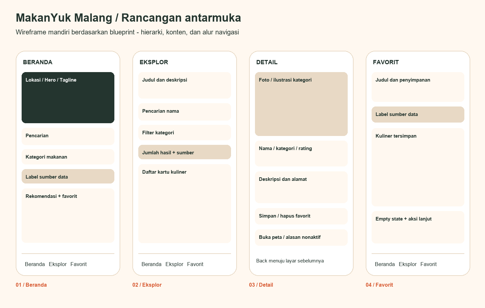

# Rancangan UI mandiri - MakanYuk Malang

Tagline: Jelajahi Rasa, Temukan Cerita.
Rancangan dikembangkan mandiri dari blueprint, tidak memakai template Dribbble.

## Design system

Primary #D75A32; background #FFF8F0; text #24352F; surface #FFFFFF;
accent #E8D9C5. Material 3 dan Plus Jakarta Sans dibundel lokal dengan lisensi OFL.
Padding halaman 24; radius kartu 24; grid 1 kolom pada smartphone,
2 kolom mulai 540 logical pixels, 3 kolom mulai 820; lebar konten maksimal 1040.
Ilustrasi kategori dipakai saat foto tidak tersedia. Rating tidak direkayasa.
Ikon Material mewakili kategori, pencarian, lokasi dan favorit dengan tooltip.

## Rancangan awal

Beranda: lokasi, hero/tagline, pencarian, kategori, rekomendasi.
Eksplor: judul, pencarian, kategori, jumlah hasil dan grid kuliner.
Detail: back, foto/ilustrasi, kategori, nama, alamat/deskripsi, favorit dan peta.
Favorit: judul, penjelasan penyimpanan lokal, grid tersimpan atau empty state.
Bottom navigation pada tiga layar utama, detail melalui route terpisah.

## Implementasi

Screenshot aplikasi asli tersedia di screenshots/ dan di laporan PDF.
Implementasi mengikuti susunan rancangan. Hero hijau gelap memberi hierarki;
aksen oranye menandai aksi utama. Setiap daftar ditampilkan dari model yang sama.
Beranda menampilkan hingga tiga rekomendasi, Eksplor menampilkan semua hasil.
Search/filter dibagi antara Beranda dan Eksplor agar pilihan konsisten.
Favorit menyimpan ID, sehingga perubahan tab maupun restart tidak menghapus pilihan.

## Keadaan dan aksesibilitas

Loading memakai skeleton dan progress; error memiliki coba lagi;
hasil kosong dan favorit kosong memiliki tindakan lanjut. Nama/alamat panjang
dibatasi pada kartu dan ditampilkan lengkap di detail. Semua layar dapat digulir.
Kartu dan detail untuk 15 referensi lokal menyediakan tombol Google dan Maps
melalui pencarian nama. Peta dinonaktifkan untuk contoh fiktif tanpa query atau
koordinat; nama/cabang terbaru perlu diperiksa pada hasil pencarian.
Label Data Demo dan informasi fallback mencegah data fiktif dianggap fakta.
